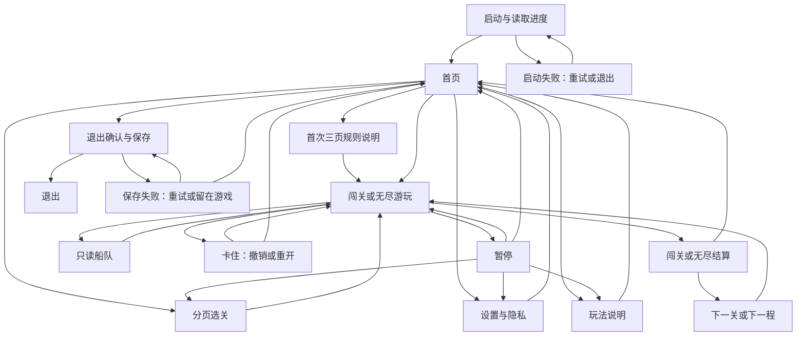

# 港口装箱完整本机流程 · v0.3.0

当前 v0.4 保留本文流程，已完成美术接入，见 [Art-Integration-v0.4.md](Art-Integration-v0.4.md)。以下为 v0.3 流程实现记录。

2026-10-16。本轮按用户要求先完成游戏构造，沿用占位美术；正式美术/UI 另开对话。用户暂不选定五版中的具体风格，首页港口展示、底部主次入口、局内分区和紧凑弹窗先对齐共同结构。引擎继续使用 Unity 6000.3.25f1，50 关与无尽规则不改，微信统一后接。

## 已接通的主流程

设置、帮助、选关实际会回到各自的发起页面；上图简化了共享页面的返回边。重开、切换未完成关卡和退出都有可取消的确认。

## 启动与进度

每次启动先显示首页，主页展示闯关完成数和无尽程数。从首页继续闯关/无尽会恢复当前局；若上次已经完成，则进入下一关/下一程；50 关全部完成仍可选关重玩或游玩无尽。

首次进入任一模式会展示三页短规则，也可以返回首页。完成后保存学习状态；已有通关、已操作的旧版闯关或已有无尽存档视为老玩家，不强制重看。设置和说明随时可从首页/暂停打开。

`activeRun` 始终保存闯关；`endless` 保存无尽的完整关卡和局面；`mode` 保存最后活动模式。首页本身是导航状态，不会清空或替换两种局面。本轮仅向 profile 增加 `tutorialCompleted` 布尔字段，旧档缺字段可正常恢复。

## 结构与替换边界

| 组件 | 负责 | 不负责 |
| --- | --- | --- |
| CompositionRoot | 载入目录、存储/规则依赖、启动重试 | 不决定装船规则 |
| GamePresenter | 棋盘输入、事务、两模式会话、解锁/存档、提示 | 不排列首页或实现菜单导航 |
| GameFlowController | 页面状态、返回路径、确认、首次说明、结算、退出 | 不改箱子/船的规则 |
| HomeView | 首页布局、文案与按钮意图 | 不直接修改游戏进度 |
| HudView / BoardView / DialogView | 各自展示、热区与状态 | 不承担保存或关卡生成 |
| Core | 50 关配置、规则、会话、求解、无尽生成、存档校验 | 无 UnityEngine 引用 |

仍然只有一个 Bootstrap 场景、一个 EventSystem 和原有三个 Canvas。HomePanel 位于 OverlayLayer 下，不增加 Canvas。原始 SampleScene 和开发文档保留。

## 本轮边界

已覆盖本机首页→游玩→暂停→结算→继续/返回→退出的功能闭环。没有增加商店、金币、皮肤、账户、排行、签到或真实广告。平台初始化、微信存储/生命周期/安全区、导出和真机验收仍在后续统一接入阶段，不能把本机构造完整理解成微信已经可发布。

正式美术/UI 的全部资产、可程序实现的部分以及非资产要求见 [Art-UI-Handoff.md](Art-UI-Handoff.md)。实际验证与包路径见 [Acceptance.md](Acceptance.md) 和 [Build.md](Build.md)。
