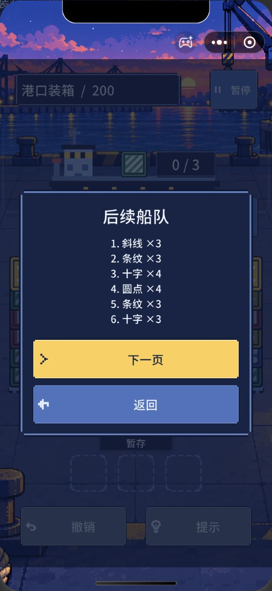
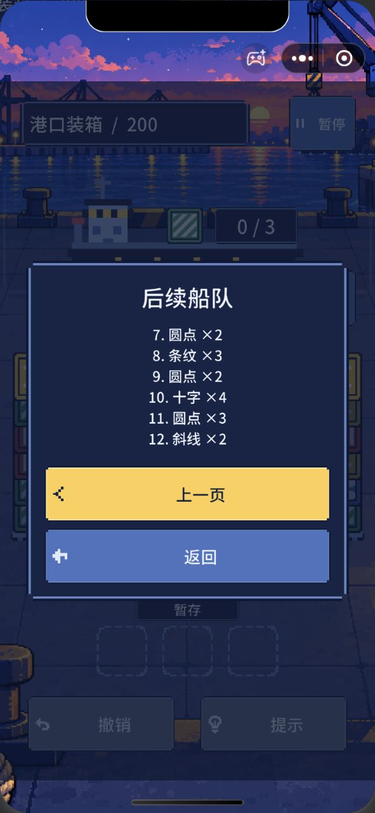

# v0.6.0 微信开发者工具验收 · 2026-10-18

本轮已在微信开发者工具中运行实际导出包，完成关键流程验收，并修复高难关船队弹窗的文字重叠。没有上传、推送手机预览或提交审核。模拟器测试不能替代微信真机测试。

## 环境与测试方法

开发者工具 2.02.2610142，基础库 3.17.4，Unity 6000.3.25f1，Unity 快适配插件 1.3.14。测试目录为 `Builds/WeChat/20261018-v0.6/minigame`。

主要交互使用 iPhone 12/13 (Pro) 模拟机型（390×844）；另用 Pixel 9（412×923）抽查首页和无尽第 61 程的密集布局与进入操作。

官方 `automation_game_action` 无法定位 Unity 画布，返回 `canvas not found`。本轮改用 macOS 原生鼠标事件，先以可访问性树定位名为“小游戏运行时”的实际视口，再把官方截图坐标映射到视口。取箱、撤销、提示、模式切换均走实际界面。没有用游戏方法调用代替取箱输入。截图仍由开发者工具 `simulator_screenshot` 取得。

为了直接验收后期内容，先备份模拟器 A/B 槽原始值，再临时装入“前 199 关完成、L200 初始局、无尽第 60 程初始局”的夹具。该夹具仅用于准备状态，不算前 199 关在微信端逐关通关。每次真实取箱后读取微信宿主存档，核对状态版本增长和对应堆高变化。

## 实际结果

| 检查 | 结果与证据 |
|---|---|
| 启动与总数 | 首页显示 200 关；初始未解锁关卡保持锁定。见 `devtools/home.jpg`、`native-levels-first.jpg`。 |
| 选关末页 | 显示 193–200 / 200，三位数关卡标签正常。见 `levels-last-page.jpg`。 |
| L200 完整游玩 | 36 次真实取箱完成；验证一次实际撤销及一次成功提示，最终显示“全部通关”。见 `campaign-pointer-replay.json`、`final-L200-completed.jpg`。 |
| 四类货物与密集布局 | 六堆、六层、36 箱可见；第四类十字货物正常显示。 |
| 无尽第 60 程 | 36 次真实取箱完成，撤销与成功提示正常；见 `endless-pointer-replay.json`、`final-endless60-completed.jpg`。 |
| 无尽第 61 程 | 点击“下一程”后仍为 36 箱，没有回落到低箱量；见 `final-endless61-initial.jpg` 和 `before-reopen.json`。 |
| 两模式独立保存 | L200 与无尽第 61 程各取一个箱子，保存中途状态和撤销历史。 |
| 项目关闭重开 | 等待窗口真正销毁，再打开新窗口；两模式的完整 run、board、undo、权益及 profile 逐字段一致。见 `reopen-result.json`。 |
| 实际续玩与撤销 | 重开后分别点击继续闯关/继续无尽，核对精确局面，再实际点击撤销并核对恢复。见 `resume-and-undo-result.json`。 |
| 安卓模拟布局 | Pixel 9 首页与 36 箱无尽第 61 程布局可见，进入操作正常；见 `pixel9-home-ready.jpg`、`pixel9-endless61-ready.jpg`。此项没有重复完整通关。 |
| 原进度恢复 | 还原测试前 A/B 槽；完整重启工具后，原 L01 run 和载荷校验值与备份一致。见 `baseline-restore-result.json`。 |

证据统一位于 [Evidence/v0.6/devtools](Evidence/v0.6/devtools)。机器可读总表为 [acceptance-summary.json](Evidence/v0.6/devtools/acceptance-summary.json)。

## 修复：十二艘船列表重叠

高难关增加到 12 艘船，旧弹窗一次绘制全部船队，导致首尾文字与标题、返回按钮重叠。`GameFlowController.ShowQueue` 现每页最多显示六艘，保留原始船队顺序，提供上一页、下一页和返回。

已在最终导出包验证 1–6 与 7–12 两页，文字和按钮分开，返回游戏不会改变棋盘。

## 控制台与边界

没有观察到游戏 C# 异常、WebGL 致命错误或错误的提示权益扣除。主测试日志有一条 **error 级的 SDK 开发提示**：建议接入 `WX.ReportGameStart` 启动统计，SDK 同时标明不影响线上版本。本轮没有为了消除提示而添加统计。不能把它描述为“控制台零红字”。分类结果见 `console-classification.json`。

其他提示包括 IndexedDB 不可用、摄像头接口不可用、帧率设置建议与最佳实践检测。本游戏使用微信同步存储桥接而非 PlayerPrefs，已另行验证宿主存档的关闭重开恢复。日志提示不等于已完成手机性能验收。

iOS 模拟器截图最上沿偶见少量裁切字形，Pixel 9 截图未见同样现象；暂记为模拟器截图/边缘绘制观察，尚未在真机确认。不据此声称所有设备视觉均已完全验收。

导出期间 IDE 自动重编译曾使自动化连接失效；最终验收在重新打开项目、确认新包运行后重新完成。临时弹出模拟器还曾使官方截图返回 2×2；恢复内嵌模式后取证，2×2 图不作为通过证据。

## 测试数据与正式包保护

运行时直接写回的备份未能稳定恢复 IDE 的宿主持久化值，因此最终停止开发者工具，只还原本轮测试项目的持久化 JSON 中两个 `portcargo.save.*` 记录，再在干净进程中重新启动正式游戏核验。其他记录和旧送审项目的存储文件未修改。

原始载荷与最终恢复后的 SHA-256 均为 `2fc04ea308e52a29209b68499306fb4d71661c3893df91cbb6e17fa9401d3dc6`。A/B revision 因正常启动保存而递增，游戏进度和设置保持原值。

排查还原问题时曾临时使用最小入口和一次性 bootstrap 读取；这些临时改动已经移除，`game.js` 与 `webgl.wasm.framework.unityweb.js` 均逐字节核对还原。最终产物重新计算指纹；入口和框架与验收时原文件一致，运行日志记录的 codeMd5/dataMd5 与最终包文件名相符。一次性恢复脚本仅存放在证据目录的 `reproduction/`，不能当作日常开发工具重复执行。

## 复现与后续

原生输入桥源码位于 `Tools/WeChat/native-input-v06.swift`；先用 `swiftc` 编译为 `/tmp/portcargo-wechat-native`。`devtools-v06.py` 负责调用已授权的 `wechatide` 并保存原始结果；`devtools-play-v06.py` 负责逐步实际输入和宿主存档断言；`devtools-reopen-v06.py`、`devtools-resume-v06.py` 负责重开与续玩检查。后期夹具由 `CoreChecks --hard-fixture` 准备，使用前必须另行备份当次模拟器存储，不复用本轮历史备份覆盖后来的进度。

尚未验证：微信 iOS/Android 真机触摸、后台恢复与系统杀进程、手机性能和发热、手机声音输出、真实广告播放与发奖，以及人类玩家的难度/留存表现。本轮广告仍未接入。

## 2026-10-18 开发版本上传

按用户要求，使用官方 `wechatide upload` 上传最终验收包，版本号 `0.6.0`，工具返回 `ok: true`、`success: true`。上传总大小 18,812,211 字节，主包 1,420,540 字节。上传前复核产物指纹与上述验收包相同。原始返回字段和上传元数据见 [upload-0.6.0.json](Evidence/v0.6/wechat/upload-0.6.0.json)。本次没有执行撤回审核、提交审核或发布线上版本操作；后台审核状态未另行读取。真机测试边界仍如上。
